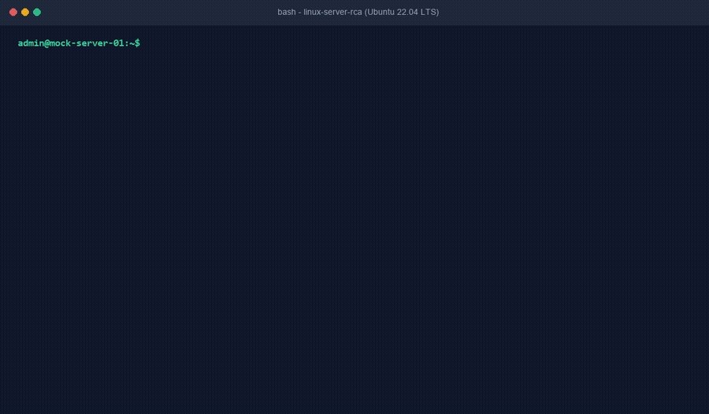

# Linux Server Root Cause Analysis (RCA) & Remediation (`linux-server-rca`)



[](https://github.com/ToritsejuBoyo/linux-server-rca/actions/workflows/tests.yml)
[](LICENSE)
[]()
[-brightgreen.svg)](CONTRIBUTING.md)
[](SECURITY.md)
[](https://agentskills.io)

> An HD recording is available in [`assets/demo.mp4`](assets/demo.mp4).

Deterministic, read-only Linux server triage and root-cause analysis skill for **RHEL, Ubuntu, Debian, Rocky Linux, and CentOS**. Analyzes crashed systemd services, kernel Out-Of-Memory (OOM) killer events, silent inode exhaustions, storage I/O wait locks, and filesystem corruption from sanitized telemetry, providing non-destructive recovery playbooks without trial-and-error rebooting.

Zero external dependencies. Python standard library and native Linux utilities only.

---

## 1. Executive Summary & Stakeholder Briefing

### The One-Sentence Pitch
A zero-dependency, read-only Linux server triage and root-cause analysis skill that rapidly diagnoses crashed systemd services, kernel OOM kills, silent inode exhaustions, and storage I/O wait bottlenecks from sanitized telemetry, outputting verified non-destructive remediation playbooks and ticket escalation briefs.

### The Real-World Problem
When a Linux production server degrades or becomes unresponsive, system administrators and on-call engineers face intense pressure. In production incidents:
1. **The Inode Blind Spot:** Applications crash reporting `No space left on device` even though `df -h` shows 50% free disk space because the inode table (`df -i`) is 100% full (often caused by millions of orphaned session files or spool queues).
2. **Silent Out-Of-Memory (OOM) Kills:** High-priority daemons (JVMs, databases, web servers) vanish silently when the Linux kernel terminates them with `SIGKILL (137)`. Without correlating `dmesg` and systemd timestamps, admins waste hours debugging application config files.
3. **Cryptic Systemd Exit Codes:** Units fail with cryptic exit status codes such as `status=203/EXEC` (missing binary or wrong file permissions) or `status=217/USER` (missing service user account) rather than standard application logs.
4. **Dangerous Guesswork:** L1/L2 engineers frequently resort to destructive quick fixes (`reboot -f`, `rm -rf /var/log/*`, `kill -9`) which destroy forensic evidence, corrupt transaction journals, or trigger extended fsck delays.

### The 3-Step Walkthrough
```
[ Step 1: Collect Telemetry ]  -->  [ Step 2: Deterministic RCA Engine ]  -->  [ Step 3: Verified Playbook ]
Read-Only Bash Script (Host)          5-Branch Diagnostic Decision Tree          Prioritized RCA + Safe Fixes
Sanitized JSON or Raw Logs            Client-Side Masking (--sanitize)           Hardening + L2 Escalation Brief
```

1. **Step 1: Collect Telemetry:** The engineer runs the read-only Bash collector (`collect-linux-rca.sh`) on the affected host, or passes an offline JSON/log bundle.
2. **Step 2: Deterministic RCA Engine:** The standalone analyzer (`parse-linux-rca.py`) processes the telemetry locally using a strict 5-branch decision tree. With `--sanitize`, private IPs, user accounts, and hostnames are hashed using SHA-256 and mapped to RFC 5737 test blocks.
3. **Step 3: Verified Playbook:** The tool outputs a structured Root Cause Analysis report with exact, non-destructive recovery commands, permanent systemd/kernel hardening steps, and an ITIL-compliant ticket escalation brief.

### Why IT Leadership Approves (CISO & VP of Infrastructure)
* **100% Read-Only Telemetry:** The collector script runs only non-mutating inspection commands (`systemctl`, `journalctl`, `dmesg`, `df`, `free`, `vmstat`, `/proc/`). It never changes configurations, restarts daemons, or deletes files.
* **Zero External Dependencies:** Built strictly using native Linux utilities (`awk`, `sed`, `grep`, `hostname`, `uname`) and the Python standard library. No `pip install`, no compiled binaries (`.exe`/`.dll`), and no unauthorized background daemons that trigger EDR/CrowdStrike alerts.
* **Least Privilege Compatible:** Functions entirely under standard user or restricted audit privileges (`sudo` only required for protected `dmesg`/`journalctl` read access in hardened environments).
* **Zero PII & Secret Leakage (Rule 4):** Automated `--sanitize` scrubs authorization tokens, passwords, and user account names, ensuring zero internal infrastructure details touch an LLM.

---

## 2. Why This Is Fundamentally Better Than What Exists

| Evaluation Dimension | Enterprise APM & Monitoring (Datadog, Dynatrace) | Ad-Hoc Google / ServerFault Searching | Raw ChatGPT / LLM Prompting | What We Built (`linux-server-rca`) |
| :--- | :--- | :--- | :--- | :--- |
| **Annual Cost** | \$15 - \$30+ per host/month (\$18,000+/yr for 100 VMs) | Free | Subscription fee | **100% Free & Open-Source (MIT)** |
| **Air-Gapped & Offline Usability** | No (requires SaaS outbound internet connectivity) | Requires internet | Requires internet | **100% Offline (Local CLI & Ollama compatible)** |
| **Time to Triage** | Minutes to navigate complex dashboards | 30 - 60 minutes manual browsing | Minutes | **< 2 Seconds (Instant Root Cause & Playbook)** |
| **Forensic Accuracy** | High (metrics-only, lacks agent decision trees) | Inconsistent / dated answers | Prone to suggesting destructive commands (`rm -rf`) | **Deterministic 5-branch decision tree with safety guardrails** |
| **Inode vs. Disk Space Isolation** | Often requires custom alert configuration | Easily overlooked by junior admins | Frequently confuses byte space with inode table capacity | **Dedicated inode saturation detection (`df -i` vs `df -h`)** |
| **Data Privacy & Sanitization** | Telemetry shipped to 3rd-party cloud | Manual copy-pasting risks leaking credentials | Leaks internal hostnames, IPs, and crash dumps to AI | **Automated local SHA-256 & RFC 5737 masking (`--sanitize`)** |
| **Actionable Non-Destructive Remediation** | Alerts only (no remediation playbook) | Generic forum suggestions | Generic or risky commands | **Exact, copy-paste recovery sequence with rollback/validation** |

---

## 3. Key Features at a Glance

* **5-Branch Deterministic Decision Tree:** Isolates root causes across systemd service failures, kernel OOM events, inode vs disk saturation, storage I/O wait locks, and filesystem read-only remounts.
* **Dual Execution Paths:** Native Bash telemetry collector for live Linux servers (`collect-linux-rca.sh`) paired with an offline Python parser (`parse-linux-rca.py`) that evaluates JSON bundles or raw pasted terminal snippets.
* **Cluster & High-Availability Awareness:** Detects clustered consensus daemons (`etcd`, `galera`, `corosync`, `pacemaker`, `consul`) and attaches mandatory split-brain/quorum warnings before proposing service restarts.
* **Non-Destructive Playbooks:** Never recommends blind reboots (`reboot -f`) or blanket deletions (`rm -rf /var/log/*`), only verified root-cause remediation and permanent systemd hardening.
* **Automated Data Sanitization:** Client-side SHA-256 host hashing, RFC 5737 test IP translation (`192.0.2.0/24`, `198.51.100.0/24`), and credential scrubbing.
* **Copy-Paste Escalation Briefs:** Automatically generates concise, formatted incident briefs ready for Jira or ServiceNow tickets.

---

## 4. Supported Diagnostic Failure Modes

### 1. Systemd Service Failures & Exit Codes
* `status=203/EXEC`: Binary path missing, corrupted, or lacking execute permissions.
* `status=217/USER`: Configured service account does not exist in `/etc/passwd`.
* `status=1/FAILURE`: Application config syntax error or unhandled runtime crash.
* `status=137/SIGKILL`: Process terminated by external signal or kernel OOM killer.
* `status=143/SIGTERM`: Graceful termination requested by shutdown or orchestrator.

### 2. Kernel Out-Of-Memory (OOM) Killer Invocations
* Detects `Out of memory: Kill process <PID> (<NAME>) score <SCORE>`.
* Identifies victim processes, verifies total-vm and anon-rss memory allocation, and recommends systemd `MemoryMax=` / `MemoryHigh=` controls and temporary emergency swapfiles.

### 3. Inode Table Exhaustion vs. Disk Space Full
* Disambiguates `df -h` (block byte capacity) from `df -i` (inode table capacity).
* Flags mount points exceeding 90% inode utilization and provides non-destructive directory isolation commands (`find -xdev -printf '%h\n'`).

### 4. Storage I/O Wait Bottlenecks
* Evaluates `%util` and `%iowait` from iostat/vmstat and `/proc/diskstats`.
* Detects tasks stuck in uninterruptible disk sleep (`D` state in `ps aux`).

### 5. Filesystem Errors & Read-Only Remounts
* Detects `EXT4-fs error ... Remounting filesystem read-only`.
* Warns against uncoordinated reboots that risk file metadata loss.

---

## 5. Installation & Setup Guide

### Prerequisites
* Python 3.10 or higher (standard library only; no external packages required).
* Any Linux distribution (RHEL, Ubuntu, Debian, Rocky Linux, CentOS, Alpine) or offline workstation (Windows, macOS).

### Option 1: Git Clone
```bash
git clone https://github.com/ToritsejuBoyo/linux-server-rca.git
cd linux-server-rca
python tests/validate-skill.py
```

### Option 2: Standalone Single-Script Download
To run the analyzer immediately on an affected machine without cloning the full repository:

**Linux / macOS:**
```bash
curl -fsSL https://raw.githubusercontent.com/ToritsejuBoyo/linux-server-rca/main/scripts/parse-linux-rca.py -o parse-linux-rca.py
python3 parse-linux-rca.py --help
```

**Windows (PowerShell):**
```powershell
Invoke-WebRequest -Uri "https://raw.githubusercontent.com/ToritsejuBoyo/linux-server-rca/main/scripts/parse-linux-rca.py" -OutFile "parse-linux-rca.py"
python parse-linux-rca.py --help
```

### Option 3: Integration into AI Agent Environments
* **Antigravity / Cursor / Claude Code:** Place this repository into your workspace `skills/linux-server-rca/` directory. The AI assistant will automatically read `SKILL.md` and execute `parse-linux-rca.py` when troubleshooting Linux issues.
* **ChatGPT Custom GPT:** Upload `SKILL.md` as knowledge and configure the script output as instructions for incident triage.

---

## 6. Local Hands-On Testing Walkthrough

You can test the entire workflow locally on your workstation using the bundled synthetic fixtures without needing access to a live Linux production server.

### Test 1: Run the Automated Verification Suite
Verify that all 7 test suites pass with exit code 0:
```bash
python tests/validate-skill.py
```

### Test 2: Triage a Kernel Out-Of-Memory (OOM) Crash
Analyze a telemetry bundle where the Linux OOM killer terminated a JVM process:
```bash
python scripts/parse-linux-rca.py -i tests/fixtures/fixture-oom-killer.json --sanitize
```

### Test 3: Triage Inode Exhaustion (Silent Disk Write Failure)
Diagnose a server where block space is 52% free, but inodes are 100% full:
```bash
python scripts/parse-linux-rca.py -i tests/fixtures/fixture-inode-exhaustion.json --sanitize
```

### Test 4: Triage Systemd `status=203/EXEC` Failure
Analyze a failed web server unit with missing executable permissions:
```bash
python scripts/parse-linux-rca.py -i tests/fixtures/fixture-systemd-failed-exec.json --sanitize
```

### Test 5: Triage Storage I/O Wait Saturation & Hung Tasks
Analyze storage device saturation with processes in uninterruptible disk sleep:
```bash
python scripts/parse-linux-rca.py -i tests/fixtures/fixture-disk-io-bottleneck.json --sanitize
```

### Test 6: Export Structured JSON for CI/CD or ServiceNow
Output machine-readable JSON for integration into automated alerting:
```bash
python scripts/parse-linux-rca.py -i tests/fixtures/fixture-oom-killer.json --format json
```

---

## 7. Automated Test Suite Summary

The included test harness (`tests/validate-skill.py`) deterministically validates:
1. **OOM Killer RCA:** Isolates kernel OOM event, victim process, and suggests memory quotas.
2. **Inode Disambiguation:** Differentiates inode exhaustion from block space capacity.
3. **Systemd Exit Code Interpretation:** Maps `status=203/EXEC` to missing binary and flags permissions.
4. **I/O Wait Saturation:** Detects storage `%util` > 85% and identifies uninterruptible sleep state.
5. **Data Sanitization (Rule 4):** Ensures hostnames are hashed with SHA-256, IPs translated to RFC 5737, and secrets scrubbed.
6. **Non-Destructive Safety Guardrails:** Verifies zero destructive commands (`rm -rf`, `reboot -f`) are present in any playbook.
7. **agentskills.io Specification Compliance:** Verifies `SKILL.md` frontmatter and zero third-party packages.

---

## 8. License

This project is licensed under the MIT License - see the [LICENSE](LICENSE) file for details.
